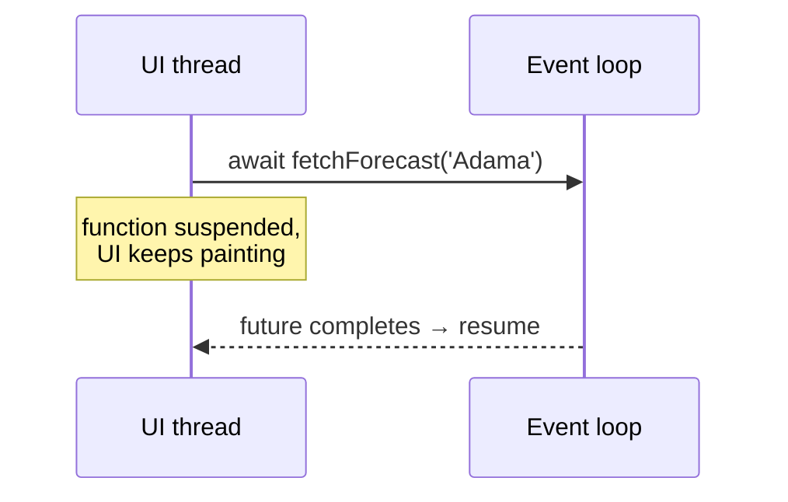
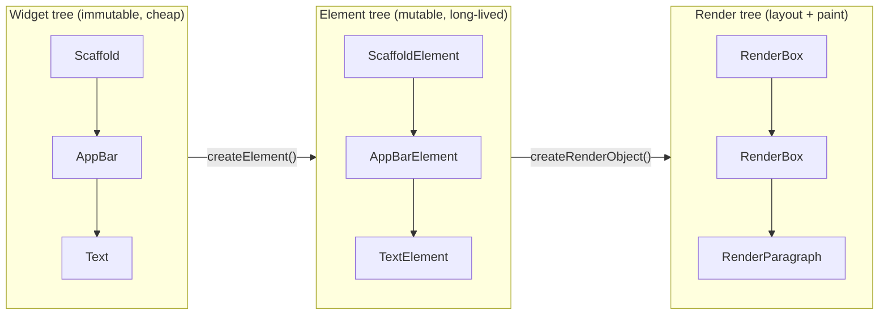
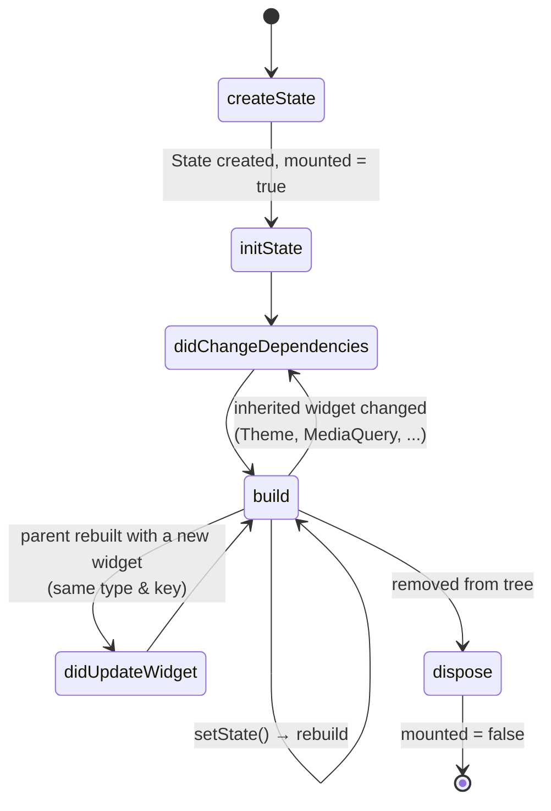

# Week 2 — Dart II and the widget lifecycle

**Outline chapters:** 3 (Learning Dart basics — classes, inheritance, mixins,
asynchronous programming), 1 (StatelessWidget and StatefulWidget lifecycle,
widget lifecycle events).
**Slides:** https://betsegawlemma.github.io/mobile-application-development-course/week02/
**Lab:** [lab/README.md](lab/README.md) · **Quiz:** [quiz.md](quiz.md)

## Learning outcomes

By the end of this week you can:

1. **Write** Dart classes with constructors, getters, inheritance, sealed
   hierarchies and generics, and **recognise and use** a given mixin or
   extension method.
2. **Use** `Future`, `async`/`await` and `Future.wait` to run work without
   blocking the UI, and **handle** errors from them.
3. **Explain** how the element tree keeps a `State` object, and the
   `StatefulWidget` lifecycle (`createState`, `initState`,
   `didChangeDependencies`, `build`, `didUpdateWidget`, `setState`,
   `dispose`); **choose** between stateless and stateful widgets.
4. **Build** a stateful screen whose UI updates with `setState`, and
   **test** it with a widget test that you write before the code.

## Before the lecture

- Read *Classes*, *Constructors*, *Mixins* and *Asynchrony support* at
  https://dart.dev/language (skip "Isolates" and "Streams").
- Read the `StatefulWidget` class doc, section *Lifecycle*:
  https://api.flutter.dev/flutter/widgets/StatefulWidget-class.html
- Make sure last week's lab is complete; this week's starter is last
  week's solution.

---

## 1. Classes

### Why this matters
Flutter is object-oriented at every level: every widget is a class, and
every piece of application data will be a class you write. Well-written
Dart classes are short, immutable where possible, and use named parameters
— the same style you see in every widget constructor.

### Worked examples and lab exercises
The code in sections 1–4 comes from **worked examples** in
`lab/starter/lib/exercises/lecture_examples.dart` and
`lab/starter/lib/exercises/lecture_widgets.dart`, with tests that show
what they do. The lab asks for similar code, but not the same: the notes
show `Course`, the lab asks for `Student`; the notes show `Assignment`,
the lab asks you to finish `Event`. Read an example until you can explain
each line, close it, and then write the lab code yourself.

### Constructors, fields, getters

```dart
// weeks/week02-dart-widgets/lab/solution/lib/exercises/lecture_examples.dart
class Course {
  Course({required this.code, required this.title, required this.credits});

  /// Named constructor for a one-credit seminar. The part after the colon
  /// is the initialiser list: it sets final fields before the body runs.
  Course.seminar(this.code)
      : title = 'Seminar',
        credits = 1;

  final String code;
  final String title;
  final int credits;

  /// A getter: callers write `course.label`, without brackets.
  String get label => '$code $title';

  bool get isHeavy => credits >= 5;

  @override
  String toString() => 'Course($code, $credits credits)';
}
```

- `this.code` in the parameter list is an *initialising formal* — it
  assigns the field directly. Almost every Dart constructor looks like this.
- Named constructors (`Course.seminar(...)`) give other ways to build an
  object. The `: field = value` part is the *initialiser list*, which runs
  before the body and can set `final` fields.
- Getters (`get label`) look like fields to callers. Use them for derived
  values instead of `getX()` methods.
- There is no `public`/`private` keyword: a leading underscore (`_balance`)
  makes a member private *to the library (file)*.

### Immutable model classes
App data — an event, a note, a user — should be immutable: all fields
`final`, a `const` constructor, and a `copyWith` method that returns a
changed copy. Immutable objects are safe to share between widgets and easy
to compare in tests. Week 5 replaces this repetitive code with code
generation (`freezed`); for now, write it by hand once so you know what
the generator produces.

```dart
// weeks/week02-dart-widgets/lab/solution/lib/exercises/lecture_examples.dart
@immutable
class Assignment {
  const Assignment({
    required this.id,
    required this.title,
    required this.due,
    this.done = false,
  });

  final String id;
  final String title;
  final DateTime due;
  final bool done;

  /// True when the assignment is not done and [now] is after the due date.
  /// [now] defaults to the real time; a test passes a fixed time instead.
  bool isOverdue({DateTime? now}) =>
      !done && (now ?? DateTime.now()).isAfter(due);

  Assignment copyWith({String? id, String? title, DateTime? due, bool? done}) {
    return Assignment(
      id: id ?? this.id,
      title: title ?? this.title,
      due: due ?? this.due,
      done: done ?? this.done,
    );
  }

  @override
  bool operator ==(Object other) =>
      other is Assignment &&
      other.id == id &&
      other.title == title &&
      other.due == due &&
      other.done == done;

  @override
  int get hashCode => Object.hash(id, title, due, done);
  // toString: see the file.
}
```

- `copyWith` takes every field as an optional nullable parameter. `??`
  keeps the old value when the caller does not pass a new one.
- `==` compares the field values, so two assignments with the same values
  are equal. If you override `==`, also override `hashCode` with the same
  fields; `Object.hash` combines them.
- `isOverdue({DateTime? now})`: passing the current time as a parameter
  makes the method testable without waiting for real time to pass. You
  will see this pattern again in week 6.

### Enhanced enums
Dart enums can have fields, constructors and methods. The lab's `Venue`
is one:

```dart
// weeks/week02-dart-widgets/lab/solution/lib/models/event.dart
enum Venue {
  mainCampus('Main campus', 'Sidist Kilo'),
  scienceFaculty('Science faculty', 'Arat Kilo'),
  technology('Technology faculty', 'Amist Kilo'),
  online('Online', 'Zoom / Teams');

  const Venue(this.label, this.location);

  final String label;
  final String location;
}
```

### Try it
Add a `String course` field to `Assignment` with a default of `''` and
update `copyWith`. What else has to change? (Equality and `hashCode`.)

---

## 2. Inheritance, sealed classes, mixins, generics, extensions

### Inheritance
`class Square extends Rectangle` — single inheritance, `super(...)` calls
the parent constructor, `@override` is expected (the analyser warns
without it). Abstract classes cannot be instantiated.

### Sealed classes and exhaustive switches
A `sealed` class can only be extended in the same file, so the compiler
knows every subtype. A `switch` over it must cover all of them — forget one
and you get a compile error, not a runtime surprise. This is how you model
"a result is either success or failure" and "a screen is loading, loaded
or showing an error" (week 5).

```dart
// weeks/week02-dart-widgets/lab/solution/lib/exercises/lecture_examples.dart
sealed class Payment {
  const Payment();
}

class CashPayment extends Payment {
  const CashPayment(this.amount);
  final double amount;
}

class CardPayment extends Payment {
  const CardPayment(this.amount, this.feePercent);
  final double amount;
  final double feePercent;
}

double totalCharged(Payment payment) => switch (payment) {
      CashPayment(:final amount) => amount,
      CardPayment(:final amount, :final feePercent) =>
        amount + amount * feePercent / 100,
    };
```

`CashPayment(:final amount)` is an *object pattern*: it matches a
`CashPayment` and takes out its `amount` in one step.

### Mixins
A mixin is a group of methods and fields you can add to a class without
inheritance: `class Lamp with Describable`. A class can use several
mixins: `class Robot with Logger, Greeter`. Flutter uses mixins often —
`SingleTickerProviderStateMixin` for animations, `WidgetsBindingObserver`
for app lifecycle events.

```dart
// weeks/week02-dart-widgets/lab/solution/lib/exercises/lecture_examples.dart
mixin Describable {
  /// The class that uses this mixin must provide [label].
  String get label;

  String describe() => 'This is $label';
}

class Lamp with Describable {
  Lamp(this.label);

  @override
  final String label;
}
```

### Generics
`List<int>`, `Future<String>`, `Pair<A, B>`: type parameters keep
collections and wrappers type-safe. Write them when you build a reusable
container; read them constantly in Flutter's API.

```dart
// weeks/week02-dart-widgets/lab/solution/lib/exercises/lecture_examples.dart
class Pair<A, B> {
  const Pair(this.first, this.second);
  final A first;
  final B second;

  Pair<B, A> swap() => Pair(second, first);
}

T firstOr<T>(List<T> items, T fallback) =>
    items.isEmpty ? fallback : items.first;
```

### Extension methods
Add methods to types you do not own:

```dart
// weeks/week02-dart-widgets/lab/solution/lib/exercises/lecture_examples.dart
extension Shorten on String {
  String shorten(int max) => length <= max ? this : '${substring(0, max)}...';
}
// 'Mobile Applications'.shorten(6)  →  'Mobile...'
```

Flutter code uses them for shortcuts such as `context.theme`.

### Exceptions
Throw an object of your own exception class, and catch it by its type
with `on`. Errors of other types still reach the caller.

```dart
// weeks/week02-dart-widgets/lab/solution/lib/exercises/lecture_examples.dart
bool tryBorrow(int count) {
  try {
    borrow(count);
    return true;
  } on NotEnoughCopiesException {
    return false;
  }
}
```

### Try it
Add a `MobileMoneyPayment` to the sealed hierarchy without updating
`totalCharged`. Run `flutter analyze` and read the error. Then fix it.

---

## 3. Asynchronous programming

### Why this matters
A phone app has one UI thread. Anything slow — network, disk, a database —
must not block it, or the screen freezes and Android shows "App isn't
responding". Dart's answer is `Future` with `async`/`await`, which lets
you write non-blocking code that reads like blocking code.

### Futures
A `Future<T>` is a value that will exist later. `await` pauses *this
function* until it does, without blocking the thread.

```dart
// weeks/week02-dart-widgets/lab/solution/lib/exercises/lecture_examples.dart
Future<String> fetchForecast(String city,
    {Duration delay = const Duration(milliseconds: 10)}) async {
  await Future<void>.delayed(delay);
  return '$city: sunny';
}

Future<List<String>> fetchForecastsInOrder(List<String> cities) async {
  final results = <String>[];
  for (final city in cities) {
    results.add(await fetchForecast(city)); // one after another
  }
  return results;
}

Future<List<String>> fetchTwoForecasts(String first, String second) {
  // both at the same time; the results keep the order of the list
  return Future.wait([fetchForecast(first), fetchForecast(second)]);
}
```

- A function marked `async` always returns a `Future`, even if you
  `return 'text'`.
- `await` only works inside `async` functions.
- `Future.wait` takes a list (any `Iterable`) of futures and runs them
  concurrently; awaiting in a `for` loop runs them one after another.
  Choose deliberately.
- Errors: an exception thrown inside an `async` function becomes a failed
  future; `await`-ing it throws the exception again, so `try`/`catch`
  around `await` works as expected.



A `Future` gives one value. For a sequence of values over time Dart has
`Stream`; week 10 starts with streams, where Firestore first needs them.

> **Optional / Advanced — Isolates.** Dart has no shared-memory threads.
> For CPU-heavy work (parsing a 10 MB JSON file, image processing) use
> `Isolate.run(() => heavyWork())`, which runs the function on another
> core and returns a `Future`. `async`/`await` alone does *not* move work
> to another thread; it only avoids blocking while waiting for I/O.

### Try it
Call `fetchForecastsInOrder` and a `Future.wait` version for five cities
with a delay of `Duration(milliseconds: 100)`. Measure both with a
`Stopwatch` and explain the numbers.

---

## 4. The StatefulWidget lifecycle

### Why this matters
Every interactive screen you build until week 5 uses `setState`, and even
after Riverpod takes over most state, you will still write stateful widgets
for animations, text fields and scroll controllers. Knowing which callback
runs when prevents two very common Flutter bugs: reading `context`
too early and forgetting to `dispose`.

### Stateless vs stateful
- `StatelessWidget`: `build()` depends only on constructor arguments.
  Immutable. Use it by default.
- `StatefulWidget`: also immutable — but it creates a `State` object that
  *persists* across rebuilds and can hold mutable fields. The widget is
  the configuration; the state is the memory.
- To choose, ask: *does this widget own a value that changes while it is
  on screen, or an object it must create and release* (a controller, a
  timer)? If yes, stateful. If its values only come from the parent,
  stateless.

### The three trees
Where does the `State` object live, if the widget is thrown away on every
rebuild? The answer is the second of Flutter's three trees. (This section
was in week 1; it is here because the lifecycle is where you need it.)
Many Flutter errors — "why did my widget not update?", "why does this
rebuild so often?" — happen because the developer does not know these
trees.



- **Widgets** are configuration. They are rebuilt constantly and thrown
  away; that is acceptable because they are small and immutable.
- **Elements** are the living instances that track where each widget sits
  in the tree, and they hold the `State` of a `StatefulWidget`. When a new
  widget arrives, the element checks "same type and key as before?" — if
  yes it *updates* itself and keeps its `State`; if no it is replaced and
  the `State` is lost. This comparison is what makes rebuilding cheap.
- **Render objects** do layout ("how big am I?") and painting.

You mostly write widgets. You touch elements through `BuildContext` (which
*is* the element) and almost never touch render objects directly.

### The lifecycle



| Callback | Runs | Use it for |
|---|---|---|
| `createState()` | once per element | only `return _MyState()` |
| `initState()` | once | subscriptions, controllers, one-off setup; call `super.initState()` first |
| `didChangeDependencies()` | after `initState`, and when an inherited widget changes | work that needs `context` (Theme, MediaQuery, Riverpod) |
| `build()` | often | describe the UI; must be pure and fast |
| `didUpdateWidget(old)` | parent gave a new widget of the same type/key | react to changed configuration |
| `setState(fn)` | you call it | mutate state *inside* `fn`, then Flutter rebuilds |
| `dispose()` | once, at removal | cancel/dispose everything from `initState`; call `super.dispose()` last |


A widget that starts a timer shows the callbacks that matter most. It
starts the timer in `initState`, restarts it in `didUpdateWidget` when the
parent passes a new interval, and cancels it in `dispose`:

```dart
// weeks/week02-dart-widgets/lab/solution/lib/exercises/lecture_widgets.dart
class _TickCounterState extends State<TickCounter> {
  Timer? _timer;
  int _ticks = 0;

  @override
  void initState() {
    super.initState(); // first
    _startTimer();
  }

  @override
  void didUpdateWidget(TickCounter oldWidget) {
    super.didUpdateWidget(oldWidget);
    // The parent rebuilt with a new TickCounter. The State is kept, so
    // compare the old and the new configuration.
    if (oldWidget.interval != widget.interval) {
      _timer?.cancel();
      _startTimer();
    }
  }

  void _startTimer() {
    _timer = Timer.periodic(widget.interval, (_) {
      setState(() => _ticks++);
    });
  }

  @override
  Widget build(BuildContext context) => Text('Ticks: $_ticks');

  @override
  void dispose() {
    _timer?.cancel(); // undo what initState started
    super.dispose(); // last
  }
}
```

Inside `State`, `widget` is the current configuration and `context` is
the element. When the parent rebuilds, Flutter reuses this `State` if the
new widget has the same type (and key) at the same place; otherwise it
disposes it and creates a new one. That is why `TickCounter` keeps its
count when the interval changes (see the test in
`test/exercises/lecture_widgets_test.dart`), but starts again at 0 if it
is removed from the tree and added again.

### setState
```dart
// weeks/week02-dart-widgets/lab/solution/lib/exercises/lecture_widgets.dart
void _vote() {
  // Change the field inside setState, so Flutter calls build() again.
  setState(() => _votes++);
}
```

`setState` marks the element as needing a rebuild; Flutter calls `build()`
on the next frame. Changing a field *without* `setState` changes the value
but not the screen — a very common first bug. Never call `setState` after
`dispose`; guard async callbacks with `if (!mounted) return;`.

### Testing a stateful widget
A widget test pumps the widget, acts on it, pumps one more frame and
checks the screen. `tester.pump()` runs one frame, which is when `build()`
runs after `setState`.

```dart
// weeks/week02-dart-widgets/lab/solution/test/exercises/lecture_widgets_test.dart
await tester.tap(find.text('Vote'));
await tester.pump(); // one frame: build() runs after setState
expect(find.text('Votes: 1'), findsOneWidget);
```

Write the test before the code when you can: run it, see it fail for the
reason you expect, then write the code that makes it pass.

Keys decide which `State` belongs to which item when a list changes;
week 7 covers them, with swipe to delete.

### Try it
In `lecture_widgets.dart`, delete the line `_timer?.cancel(); // undo
what initState started` from `dispose`. Run
`flutter test test/exercises/lecture_widgets_test.dart` and read the
error. Which callback should have released the timer? Put the line back.

---

## Common mistakes

1. **Calling `setState` after the widget is gone** ("setState() called
   after dispose()"). Happens when an `await` finishes after the user
   left the screen. Check `mounted` first.
2. **Reading `Theme.of(context)` or `MediaQuery.of(context)` in
   `initState`.** Inherited widgets are not available yet; use
   `didChangeDependencies` or `build`.
3. **Forgetting `dispose`** for `TextEditingController`, `AnimationController`,
   `StreamSubscription`, `Timer`. This keeps memory in use and causes
   errors later.
4. **Putting slow or side-effecting work in `build`.** `build` can run
   sixty times a second. Fetch data in `initState` (or, from week 5, a
   provider).
5. **Changing state outside `setState`** — the value changes, the screen
   does not.
6. **`await` in a loop when you meant concurrency** — five 1-second calls
   take 5 s one after another, 1 s with `Future.wait`.
7. **A future that nobody awaits** — the analyser's `unawaited_futures`
   lint reports futures that are started but never awaited; either `await`
   them or wrap them in `unawaited(...)` deliberately.
8. **Mutable model classes** (`String title;` without `final`). Two
   widgets share one object, one changes it, the other never finds out.

## Industry note

Immutable models with `copyWith`, sealed result types, and passing the
current time as a parameter are three habits that code reviewers look for
when judging whether a developer is beyond the beginner level. All three
appear here in a small form and return in weeks 5 and 6 in full. Reviewers
in Flutter teams usually check `dispose` and `mounted` first in a pull
request.

## Further reading

- Classes: https://dart.dev/language/classes ·
  Constructors: https://dart.dev/language/constructors
- Class modifiers (`sealed`, `final`, `base`):
  https://dart.dev/language/class-modifiers
- Patterns: https://dart.dev/language/patterns
- Asynchrony: https://dart.dev/libraries/async/async-await
- `State` lifecycle: https://api.flutter.dev/flutter/widgets/State-class.html

## Key terms

All key terms of the course, in one list: [`guides/glossary.md`](../../guides/glossary.md).

- **initialising formal** — `this.name` in a constructor's parameter list;
  it sets the field directly.
- **initialiser list** — the part after `:` in a constructor; it sets
  `final` fields before the body runs.
- **getter** — a method written `get name` that callers use like a field.
- **immutable** — cannot be changed after it is created; changes make a
  new object.
- **`copyWith`** — a method that returns a copy of an object with some
  fields changed.
- **value equality** — two objects are `==` when their fields are equal,
  not only when they are the same object.
- **enhanced enum** — an enum whose values have fields and a constructor.
- **sealed class** — a class whose subtypes are all in the same file, so a
  `switch` over it can be checked for missing cases.
- **object pattern** — `CashPayment(:final amount)`: matches a type and
  takes out its fields.
- **mixin** — a group of methods and fields that a class adds with `with`.
- **generic** — a class or function with a type parameter, such as `<T>`.
- **extension method** — a method added to an existing type with
  `extension ... on`.
- **`Future`** — a value that will be ready later.
- **`async` / `await`** — mark a function that returns a `Future` / wait
  for a `Future` inside it without blocking the thread.
- **element** — the long-lived object that holds a widget's place in the
  tree and, for a `StatefulWidget`, its `State`.
- **`State`** — the object that keeps a `StatefulWidget`'s changing values
  between rebuilds.
- **lifecycle callback** — a `State` method Flutter calls at a fixed
  moment: `initState`, `didChangeDependencies`, `build`,
  `didUpdateWidget`, `dispose`.
- **`setState`** — tells Flutter that the `State` changed, so `build()`
  runs again.
- **`mounted`** — true while the `State` is in the tree; check it after an
  `await`.
- **widget test** — a test that pumps widgets with `WidgetTester` and
  checks what is on screen.
