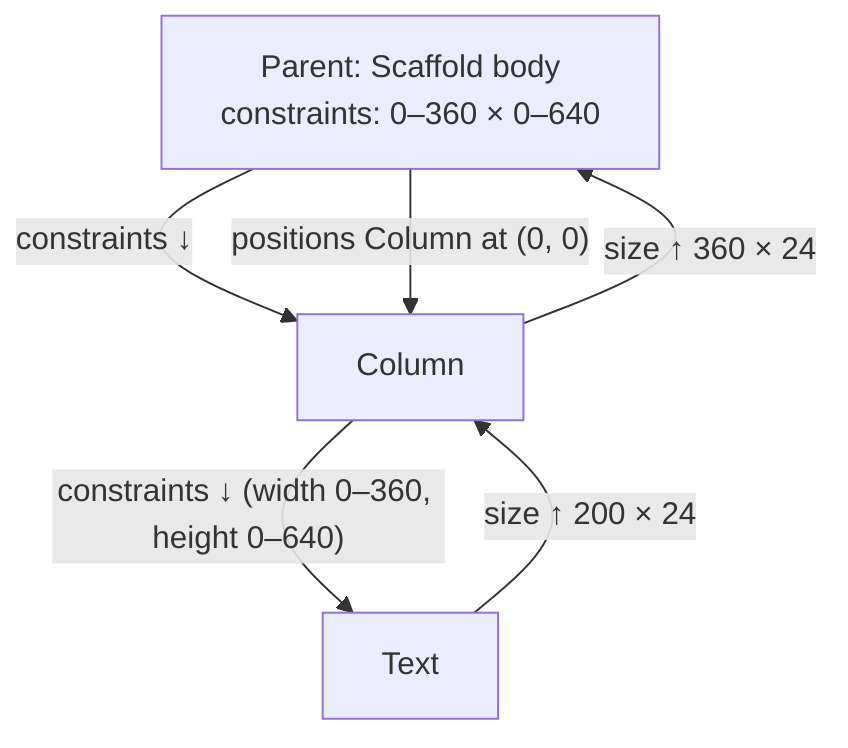

# Week 3 — Layout and common widgets; responsive design

**Outline chapter:** 4 (Using common widgets: SafeArea, Container, Text,
RichText, Column, Row, buttons, FloatingActionButton, AssetBundle, checking
orientation).
**Slides:** https://betsegawlemma.github.io/mobile-application-development-course/week03/
**Lab:** [lab/README.md](lab/README.md) · **Quiz:** [quiz.md](quiz.md)

## Learning outcomes

By the end of this week you can:

1. **Explain** Flutter's layout rule — *constraints go down, sizes go up,
   parent sets position* — **trace** the constraints through a small
   widget tree, and **diagnose** the two errors the rule produces
   (overflow, unbounded height).
2. **Compose** screens from `Row`, `Column`, `Expanded`, `Flexible`,
   `Container`, `Padding`, `SizedBox`, `Stack`, `Wrap` and `ListView`, and
   **choose** the widgets for a card from a described design.
3. **Style** text with `Text`, `RichText` and the Material 3 `TextTheme`,
   and **use** the button family correctly.
4. **Bundle** images with the `AssetBundle` and **adapt** a layout to
   orientation and width with `MediaQuery` and `LayoutBuilder`.
5. **Test** a layout at a narrow width with a widget test that you write
   before the code, and **check** an assistant's layout code with the
   analyser, a test and the documentation.

## Before the lecture

- Read *Understanding constraints* — the most important page in the
  Flutter documentation: https://docs.flutter.dev/ui/layout/constraints
- Skim *Layouts in Flutter*: https://docs.flutter.dev/ui/layout
- Draft your project proposal (`project/proposal-template.md`); it is due
  at the end of week 3.

---

## 1. The one layout rule

### Why this matters
Every layout error you will see in Flutter — the yellow-and-black
overflow stripes, "RenderBox was not laid out", "Vertical viewport was
given unbounded height" — is a violation of one rule. Learn the rule and
the errors become understandable.

### Constraints go down, sizes go up, parent sets position

1. A parent tells its child the **constraints**: minimum and maximum
   width and height.
2. The child picks its **size** within those constraints and tells the
   parent.
3. The parent decides the child's **position**.



Consequences that you will see in the lab:

- A widget **cannot** have any size it wants; it can only choose within
  the constraints it was given. `width: 1000` inside a 360-wide parent
  gives you 360.
- A `Column` gives its children **unbounded height** ("be as tall as you
  like") unless you use `Expanded`. Put a `ListView` (which wants to fill
  all available height) directly in a `Column` and it asks "how tall?",
  gets "infinite", and throws. Fix: wrap the `ListView` in `Expanded`.
- A `Row` gives its children unbounded **width**. A long `Text` in a `Row`
  overflows to the right. Fix: wrap it in `Expanded` (or `Flexible`) so it
  gets a bounded width and can wrap.

```dart
// weeks/week03-layout/lab/solution/lib/screens/home_screen.dart
// Expanded gives the section the rest of the column's height;
// without it a ListView inside a Column has unbounded height and
// throws.
Expanded(
  child: switch (_section) {
    _Section.events => const EventsScreen(),
    _Section.profile => const ProfileScreen(),
    _Section.checkIn => const CheckInScreen(),
  },
),
```

### Tight, loose, bounded, unbounded
- **Tight**: min == max (e.g. `SizedBox(width: 56)` gives its child a tight
  width).
- **Loose**: min 0, max something (a `Center` gives loose constraints —
  the child may be smaller).
- **Unbounded**: max is infinity (inside scrollables and along a
  `Row`/`Column`'s main axis).

### Try it
In the lab starter, temporarily remove the `Expanded` around the section
switch in `home_screen.dart` and hot reload. Read the error. Put it back.

---

## 2. The building blocks

### Worked examples and lab tasks
The code in sections 2–7 comes from **worked examples** in
`lab/starter/lib/exercises/lecture_layouts.dart`, with tests in
`test/exercises/lecture_layouts_test.dart`. You can run them on their
own:

```bash
flutter run -d chrome -t lib/exercises/lecture_layouts.dart
```

The lab asks for similar layouts, but not the same: the notes show
`ContactTile`, the lab asks for `EventCard`; the notes show `RoomsPage`,
the lab asks for `EventsScreen`; the notes show `CoursePage`, the lab asks
for `ProfileScreen`. Read an example until you can explain each widget,
close it, and then write the lab code yourself.

### Single-child helpers
| Widget | Purpose |
|---|---|
| `Container` | decoration (colour, border, radius, shadow), padding, margin, fixed size, alignment — a convenience bundle |
| `Padding` | only padding; lighter than a `Container` when that is all you need |
| `SizedBox` | fixed width/height, or a spacer (`SizedBox(height: 16)`) |
| `Center`, `Align` | position a child within loose constraints |
| `SafeArea` | inset content away from the notch, status bar and home indicator |
| `ConstrainedBox`, `LimitedBox`, `AspectRatio` | adjust constraints |

```dart
// weeks/week03-layout/lab/solution/lib/exercises/lecture_layouts.dart
// (ContactTile: the round box with the initials)
Container(
  width: 48,
  height: 48,
  alignment: Alignment.center,
  decoration: BoxDecoration(
    color: colors.secondaryContainer,
    shape: BoxShape.circle,
  ),
  child: Text(/* initials */),
),
```

Note: `Container` with a `decoration` cannot also take `color:` — put the
colour inside the `BoxDecoration`.

### Multi-child: Row and Column
Both are *flex* layouts. The **main axis** is horizontal for `Row`,
vertical for `Column`; the **cross axis** is the other.

- `mainAxisAlignment` — how children are spaced along the main axis
  (`start`, `center`, `spaceBetween`, …).
- `crossAxisAlignment` — how children are aligned on the cross axis
  (`start`, `center`, `stretch`, …).
- `mainAxisSize` — `max` (default: fill the main axis) or `min`.
- `Expanded(child)` — take a share of the *remaining* main-axis space
  (`flex: 2` for a double share). `Flexible` is the same but the child may
  be smaller than its share.
- `Spacer()` — an empty `Expanded`.

```dart
// weeks/week03-layout/lab/solution/lib/exercises/lecture_layouts.dart
// (CoursePage: three figures that share the width)
final figures = Row(
  children: [
    // Expanded shares the row's width equally between the figures.
    Expanded(
      child: _Figure(value: '$credits', label: 'Credits'),
    ),
    const Expanded(
      child: _Figure(value: '14', label: 'Weeks'),
    ),
    const Expanded(
      child: _Figure(value: '13', label: 'Labs'),
    ),
  ],
);
```

### A row that cannot overflow
A `Row` with a fixed part, a part that takes the rest, and an optional
icon is the most common layout in a list. `ContactTile` shows a staff
member:

```dart
// weeks/week03-layout/lab/solution/lib/exercises/lecture_layouts.dart
// (ContactTile.build, shortened)
Row(
  children: [
    Container(width: 48, height: 48, /* initials */),
    const SizedBox(width: 12),
    // Expanded gives the column the width that is left, so a long
    // name gets a bounded width and can end in "...". Remove it and
    // a long name overflows to the right.
    Expanded(
      child: Column(
        crossAxisAlignment: CrossAxisAlignment.start,
        children: [
          Text(
            name,
            style: theme.textTheme.titleMedium,
            maxLines: 1,
            overflow: TextOverflow.ellipsis,
          ),
          Text.rich(/* role · office */),
        ],
      ),
    ),
    if (online) Icon(Icons.circle, /* ... */),
  ],
),
```

Trace the constraints at 320 pixels. The `Card` has a margin of 4 pixels
on each side and the `Padding` 12, so the `Row` gets exactly 288 pixels.
The `Row` first lays out the children without flex: the box takes 48, the
gap 12 and the icon 12. The `Expanded` gets the rest, 216 pixels, as a
*tight* width. The `Column` passes a width of 0 to 216 to the name, so a
long name ends in "…" at 216 pixels.

**Predict, then try.** What happens if you remove the `Expanded` and the
name is very long? Write your answer down first, then try it in the
example app.

### Wrap, Stack, ListView
- `Wrap` — like a `Row` that wraps to the next line when it runs out of
  space. Use it for chips and button groups.
- `Stack` — layers children on top of each other; `Positioned` places
  them. Badges, overlays, image captions.
- `ListView` — a scrolling column. Always prefer `ListView.builder` for
  lists that can grow: it builds only the visible items.
- `SingleChildScrollView` — makes one tall child scrollable. Use it for
  forms and detail pages, not for lists.
- `GridView` — like `ListView` in two dimensions.

```dart
// weeks/week03-layout/lab/solution/lib/exercises/lecture_layouts.dart
// (RoomsPage, narrow screens)
// ListView.builder builds only the items that are visible.
return ListView.builder(
  padding: const EdgeInsets.all(8),
  itemCount: rooms.length,
  itemBuilder: (context, index) => _RoomTile(name: rooms[index]),
);
```

### Try it
In `CoursePage`, give the figures `Row` the argument
`mainAxisAlignment: MainAxisAlignment.spaceAround` and remove the three
`Expanded`. Predict first: what changes on a narrow and on a wide window?
Why does the `Expanded` version share the width the same way on every
screen width?

---

## 3. Text, RichText and the theme

`Text` shows one style. `Text.rich` (or `RichText`) shows a tree of
`TextSpan`s with different styles in one paragraph:

```dart
// weeks/week03-layout/lab/solution/lib/exercises/lecture_layouts.dart
// (ContactTile: the role in bold, then the office)
Text.rich(
  TextSpan(
    children: [
      TextSpan(
        text: role,
        style: const TextStyle(fontWeight: FontWeight.w600),
      ),
      TextSpan(text: ' · $office'),
    ],
  ),
  style: theme.textTheme.bodyMedium,
),
```

`Text.rich` uses the default text style of the screen as its base.
`RichText` does **not**: with `RichText` you must give the root `TextSpan`
a `style`, or the text appears in a small fallback style. Prefer
`Text.rich` in most cases. (Inside, `Text.rich` builds a `RichText`, so a
test that looks for a `RichText` finds both.)

**Overflow.** `Text` overflows its parent without any error at compile
time. Give it a bounded
width (`Expanded` in a `Row`) and set `maxLines` and
`overflow: TextOverflow.ellipsis`.

**Theme.** Do not hard-code font sizes. Material 3 defines a
`TextTheme` — `displayLarge` … `bodySmall`, `labelSmall` — and a
`ColorScheme` (`primary`, `primaryContainer`, `onPrimaryContainer`,
`surfaceContainerHighest`, …). Read them with `Theme.of(context)` and
adjust with `copyWith`:

```dart
// weeks/week03-layout/lab/solution/lib/exercises/lecture_layouts.dart
// (ContactTile: the initials)
Text(
  initials,
  style: theme.textTheme.titleMedium?.copyWith(
    color: colors.onSecondaryContainer,
  ),
),
```

The app's whole palette comes from one seed colour in `app.dart`
(`colorSchemeSeed`). Change it and every `primaryContainer` follows.

---

## 4. Buttons

Material 3 has a family; pick by emphasis, not by look:

| Widget | Emphasis | Use |
|---|---|---|
| `FilledButton` | high | the one main action on a screen |
| `FilledButton.tonal` | medium-high | secondary action that still matters |
| `ElevatedButton` | medium | legacy-looking raised button; rarer in M3 |
| `OutlinedButton` | medium | secondary action |
| `TextButton` | low | dialogs, "cancel", inline links |
| `IconButton` | low | toolbar and inline actions; always set `tooltip` |
| `FloatingActionButton` | highest | the screen's primary *creative* action (add, compose) |
| `SegmentedButton` | — | pick one of a few options |

All take `onPressed`; pass `null` to disable. `.icon` constructors add a
leading icon.

```dart
// weeks/week03-layout/lab/solution/lib/exercises/lecture_layouts.dart
// (CoursePage: one main action, one secondary, one low, one icon)
// Wrap: the buttons go onto a second line when the width runs out.
final actions = Wrap(
  spacing: 8,
  runSpacing: 8,
  alignment: WrapAlignment.center,
  children: [
    FilledButton.icon(
      onPressed: () {},
      icon: const Icon(Icons.how_to_reg),
      label: const Text('Enrol'),
    ),
    OutlinedButton(onPressed: () {}, child: const Text('Syllabus')),
    TextButton(onPressed: () {}, child: const Text('Not now')),
    IconButton(
      onPressed: () {},
      icon: const Icon(Icons.share),
      tooltip: 'Share',
    ),
  ],
);
```

---

## 5. Assets

Images, fonts, JSON and other files are bundled into the app through the
**AssetBundle**. Two steps:

1. Put the file under `assets/` and declare the folder in `pubspec.yaml`:
   ```yaml
   flutter:
     uses-material-design: true
     assets:
       - assets/images/
   ```
2. Reference it: `Image.asset('assets/images/logo.png')`,
   `AssetImage(...)`, or `rootBundle.loadString('assets/data/x.json')`.

Forgetting step 1 is the most common asset bug: the app builds, then
throws *Unable to load asset* at runtime. After editing `pubspec.yaml`,
hot restart (assets are read at startup).

Resolution variants (`2.0x/`, `3.0x/` subfolders) let Flutter pick the
right density automatically.

---

## 6. Responsive and adaptive layout

### Orientation
```dart
// weeks/week03-layout/lab/solution/lib/exercises/lecture_layouts.dart
// (CoursePage)
// orientationOf rebuilds this widget only when the orientation changes.
final isLandscape =
    MediaQuery.orientationOf(context) == Orientation.landscape;
```

`MediaQuery.orientationOf` (and `sizeOf`, `paddingOf`, …) subscribe only to
that property, so the widget rebuilds only when it changes. Prefer these
over `MediaQuery.of(context).orientation`, which rebuilds on *any* change
(keyboard opening, for example).

`CoursePage` puts the header beside the rest in landscape and above it in
portrait — the same widgets, a different container:

```dart
// weeks/week03-layout/lab/solution/lib/exercises/lecture_layouts.dart
// (CoursePage)
return SingleChildScrollView(
  padding: const EdgeInsets.all(16),
  child: isLandscape
      ? Row(
          crossAxisAlignment: CrossAxisAlignment.start,
          children: [
            Expanded(child: header),
            const SizedBox(width: 24),
            Expanded(
              child: Column(
                children: [figures, const SizedBox(height: 16), actions],
              ),
            ),
          ],
        )
      : Column(
          children: [
            header,
            const SizedBox(height: 24),
            figures,
            const SizedBox(height: 16),
            actions,
          ],
        ),
);
```

### Width, not device
Orientation is a coarse signal. Tablets in portrait are wider than phones
in landscape. `LayoutBuilder` gives you the constraints of *this* widget,
which is what matters:

```dart
// weeks/week03-layout/lab/solution/lib/exercises/lecture_layouts.dart
// (RoomsPage)
return LayoutBuilder(
  builder: (context, constraints) {
    if (constraints.maxWidth >= wideBreakpoint) {
      return GridView.builder(
        padding: const EdgeInsets.all(8),
        gridDelegate: const SliverGridDelegateWithFixedCrossAxisCount(
          crossAxisCount: 3,
          mainAxisExtent: 72,
        ),
        itemCount: rooms.length,
        itemBuilder: (context, index) => _RoomTile(name: rooms[index]),
      );
    }
    return ListView.builder(/* as in section 2 */);
  },
);
```

A grid cell has a fixed height (`mainAxisExtent`). If the content of a
cell is taller, it overflows at the bottom, so measure the cell with the
largest realistic content.

Common breakpoints: < 600 compact (phone), 600–840 medium (tablet
portrait, foldable), ≥ 840 expanded (tablet landscape, desktop).

> **Optional / Advanced.** `OrientationBuilder`, `FittedBox`,
> `FractionallySizedBox`, and the `flutter_adaptive_scaffold` package for
> navigation-rail-vs-bottom-bar switching.

### Try it
Run the example app on Chrome, choose *Rooms*, and drag the window
narrower and wider than 600 px. Watch the page switch between list and
grid without a restart.

---

## 7. Testing a layout, and checking an assistant's layout code

### Why this matters
An overflow on a small phone is easy to miss when you develop on a wide
laptop screen. In a widget test, an overflow is reported as an exception,
so a test at a narrow width finds it every time.

```dart
// weeks/week03-layout/lab/solution/test/exercises/lecture_layouts_test.dart
await tester.pumpWidget(
  wrap(
    SizedBox(
      width: 320,
      child: ContactTile(
        name: 'A very long name ' * 10,
        role: 'Lecturer',
        office: 'Room 214',
        online: true,
      ),
    ),
  ),
);

// A RenderFlex overflow is reported as an exception in a test.
expect(tester.takeException(), isNull);
```

Two details:

- The `Scaffold` body gives its child a *loose* width, so the
  `SizedBox(width: 320)` really is 320 pixels wide.
- In a widget test every letter is drawn as a square box. Text is wider
  than on a phone, so a test at 320 pixels is a strict check.

Write such a test **before** you build a screen: it fails while the screen
is missing, and it keeps failing until the screen fits.

### Checking an assistant's layout code
Layout code from an assistant often looks right, compiles (or almost),
and works for the short example it shows. Check it in three ways:

1. **The analyser.** It finds parameters that do not exist. Assistants
   sometimes use a parameter from a similar widget.
2. **A test at a narrow width,** with the longest text you expect.
3. **The documentation.** Compare each claim about constraints with the
   class documentation. For example, the `Row` documentation has a
   section "Layout algorithm" that says which width each child gets. In
   your editor, hover over a class name to read the same text offline.

The lab has an assistant's answer for you to check in this way.

---

## Common mistakes

1. **`ListView` directly inside a `Column`** → "Vertical viewport was
   given unbounded height". Wrap it in `Expanded`.
2. **Long `Text` inside a `Row`** → overflow stripes on the right. Wrap it
   in `Expanded` and set `overflow`.
3. **`Container(color: x, decoration: y)`** → assertion error. Colour
   goes inside `BoxDecoration`.
4. **Asset not declared in `pubspec.yaml`** → "Unable to load asset".
   Declare the folder, hot restart.
5. **Hard-coded sizes and colours** (`fontSize: 18`, `Colors.blue`) →
   inconsistent UI, wrong in dark mode. Use `Theme.of(context)`.
6. **`ListView(children: [...])` for a long list** → builds every item
   up front; use `ListView.builder`.
7. **A fixed-height grid cell smaller than its content** → overflow that
   only appears on some devices or fonts. Measure with the largest
   realistic content, or let the cell size itself.
8. **`RichText` without a root style** → tiny black text. Set
   `style:` on the root `TextSpan`, or use `Text.rich`.
9. **`overflow: TextOverflow.ellipsis` on a `Text` with an unbounded
   width** → no "…", only overflow stripes. The ellipsis works only when
   the width is bounded (for example by `Expanded`); add `maxLines: 1`
   for a single line.

## Industry note

Designers deliver Figma files with fixed pixel frames. Your job is to
translate them into *constraints*, not pixels: which elements stretch,
which wrap, which scroll, and what happens at 320 dp and at 1024 dp.
Reviewers at product companies check overflow on small screens and with
large fonts (accessibility settings) before anything else. Test the
extreme cases early: a widget test with `SizedBox(width: 320, ...)`, as
in section 7, does it automatically.

## Further reading

- Understanding constraints: https://docs.flutter.dev/ui/layout/constraints
- Layout widgets catalogue: https://docs.flutter.dev/ui/widgets/layout
- Material 3 in Flutter: https://docs.flutter.dev/ui/design/material
- Adding assets and images: https://docs.flutter.dev/ui/assets/assets-and-images
- Adaptive and responsive design: https://docs.flutter.dev/ui/adaptive-responsive

## Key terms

All key terms of the course, in one list: [`guides/glossary.md`](../../guides/glossary.md).

- **constraints** — the minimum and maximum width and height that a
  parent gives its child.
- **tight constraint** — minimum and maximum are the same, so the child
  has exactly that size.
- **loose constraint** — the minimum is 0, so the child may be smaller
  than the maximum.
- **unbounded** — the maximum is infinity; the child can be as large as it
  wants in that direction.
- **main axis / cross axis** — for a `Row`, horizontal / vertical; for a
  `Column`, vertical / horizontal.
- **flex** — the share of the remaining space that an `Expanded` or
  `Flexible` child gets.
- **overflow** — a child is larger than the space its parent has; Flutter
  draws yellow and black stripes and reports an error.
- **ellipsis** — the "…" that replaces the end of a text that does not
  fit.
- **`TextTheme` / `ColorScheme`** — the named text styles and colours of
  the app's theme, read with `Theme.of(context)`.
- **asset** — a file (image, font, data) bundled into the app and declared
  in `pubspec.yaml`.
- **breakpoint** — the width at which a layout changes, for example from
  a list to a grid at 600 pixels.
- **responsive layout** — a layout that changes with the space it has.
