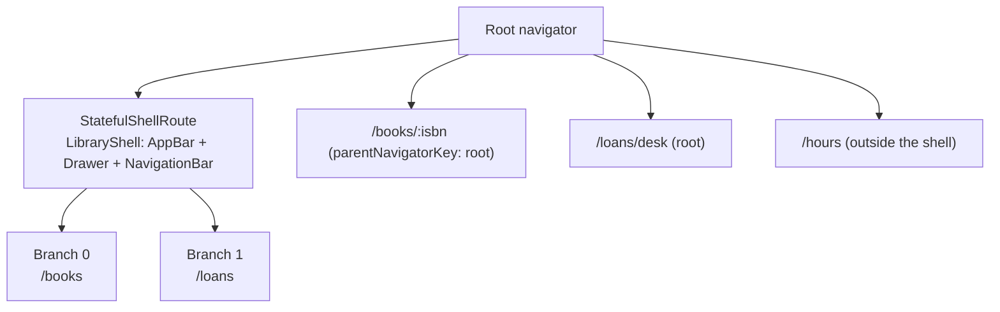

# Week 4 — Navigation

**Outline chapter:** 5 (Creating an app's navigation: Navigator, named
routes, BottomNavigationBar, BottomAppBar, TabBar and TabBarView, Drawer
and ListView).
**Slides:** https://betsegawlemma.github.io/mobile-application-development-course/week04/
**Lab:** [lab/README.md](lab/README.md) · **Quiz:** [quiz.md](quiz.md)

## Learning outcomes

By the end of this week you can:

1. **Push and pop** screens with the imperative `Navigator` API, **pass**
   data forward and **return** results backward.
2. **Trace** how named routes and `onGenerateRoute` turn a name such as
   `/events/42` into a screen, and **explain** why named routes are not
   enough for deep links, web URLs and nested navigation.
3. **Configure** `go_router` with a stateful shell (bottom navigation with
   per-tab back stacks), nested routes, path and query parameters, and an
   error page.
4. **Choose** between `NavigationBar`/`BottomNavigationBar`,
   `BottomAppBar`, `TabBar`/`TabBarView` and `Drawer`, and between the
   root navigator and a branch navigator, and **give a reason** for the
   choice.
5. **Write** a navigation widget test before the code that makes it pass.

## Before the lecture

- Read *Navigation and routing* (overview):
  https://docs.flutter.dev/ui/navigation
- Read the `go_router` *Get started* and *Configuration* pages:
  https://pub.dev/documentation/go_router/latest/topics/Get%20started-topic.html
- Your project proposal is due on Sunday 8 November 2026: `PROPOSAL.md`
  in the root of your group repository, with the tag `proposal`.

---

## 1. Navigator 1.0: a stack of pages

### Why this matters
Every mobile app is a stack of screens: you open a detail page on top of
a list, and the back button pops it off. Flutter's `Navigator` widget *is*
that stack, and `MaterialApp` gives you one at the root. Even after we
adopt `go_router`, it uses `Navigator` internally, so the same model
applies.

### Worked examples
The examples in this section and the next ones are complete apps in
`lab/starter/lib/exercises/`, with tests in `test/exercises/`:

- `named_routes_demo.dart` — Navigator 1.0 with named routes;
- `lecture_navigation.dart` — a small campus library app with
  `go_router`: books, loans, a drawer and a page that returns a result.

Each lab task is similar to one of them, but not the same. Run them on
their own:

```bash
flutter run -d chrome -t lib/exercises/named_routes_demo.dart
flutter run -d chrome -t lib/exercises/lecture_navigation.dart
```

### Push and pop
`Navigator.push` puts a route on top of the stack; `Navigator.pop` removes
the top one. `MaterialPageRoute` supplies the platform transition and a
back button in the `AppBar` automatically. The Android back gesture and
the iOS swipe both call `pop`.

### Passing data forward and back
- **Forward**: constructor arguments (`DemoCampusPage(current: _campus)`).
  Nothing else is needed — no bundles, no serialisation.
- **Back**: `Navigator.pop(context, result)` returns a value to whoever
  awaited the `push`. `push<T>` is generic so the result is typed. When
  the user goes back without choosing, the result is `null`.

```dart
// weeks/week04-navigation/lab/solution/lib/exercises/named_routes_demo.dart
Future<void> _chooseCampus() async {
  final campus = await Navigator.push<String>(
    context,
    MaterialPageRoute(builder: (context) => DemoCampusPage(current: _campus)),
  );
  if (!mounted || campus == null) return;
  setState(() => _campus = campus);
}

// in DemoCampusPage, when the user taps a campus:
onTap: () => Navigator.pop(context, campus),
```

The `mounted` check is the one from week 2: after an `await`, the screen
may have been closed.

**Which navigator?** `Navigator.push(context, …)` uses the *nearest*
navigator above `context`. In an app with a bottom bar where each tab has
its own navigator (section 3), that is the tab's navigator, not the root
one.

### Named routes and their limits
A named route gives a screen a name. `MaterialApp.routes` maps fixed
names to screens; `onGenerateRoute` is called for every name that is not
in the map, and `onUnknownRoute` when `onGenerateRoute` returns `null`.

```dart
// weeks/week04-navigation/lab/solution/lib/exercises/named_routes_demo.dart
routes: {
  '/': (context) => const DemoHomePage(),
  '/events': (context) => const DemoEventListPage(),
},
onGenerateRoute: generateDemoRoute,
onUnknownRoute: (settings) => MaterialPageRoute<void>(
  settings: settings,
  builder: (context) => DemoNotFoundPage(name: settings.name ?? ''),
),
```

Callers then use the name, not the class:
`Navigator.pushNamed(context, '/events')`. This is the approach in the
course outline and you will see it in older code. A name with a
parameter, such as `/events/42`, has to be taken apart by hand:

```dart
// weeks/week04-navigation/lab/solution/lib/exercises/named_routes_demo.dart
Route<void>? generateDemoRoute(RouteSettings settings) {
  final segments = Uri.parse(settings.name ?? '').pathSegments;
  if (segments.length == 2 && segments[0] == 'events') {
    final id = int.tryParse(segments[1]);
    final event = demoEvents.where((e) => e.id == id).firstOrNull;
    if (event != null) {
      return MaterialPageRoute<void>(
        settings: settings,
        builder: (context) => DemoEventPage(event: event),
      );
    }
  }
  return null;
}
```

Named routes are not enough in three ways that matter on real projects:

1. **No parameters in the path**: every parameter means more parsing code
   like the function above.
2. **No nested navigation**: a bottom bar where each tab keeps its own
   back stack is hard.
3. **No deep links / web URLs**: the browser address bar and Android App
   Links need a declarative mapping from a URL to a screen.

Flutter's answer is the *Router* API (Navigator 2.0), which is powerful
but requires a lot of code. `go_router` is the Flutter team's package
that makes it practical. We use it from here on.

### Try it
Read `generateDemoRoute` and write down what it returns for each name:
`/events/7`, `/events/5`, `/events/abc`, `/events/7/photos`. Then check
your answers with the test "generateDemoRoute parses the id or returns
null" in `test/exercises/named_routes_demo_test.dart`.

---

## 2. go_router

### Declarative routes
A `GoRouter` is a list of `GoRoute`s mapping a **path** to a **builder**.
Nested routes build nested paths.

```dart
// weeks/week04-navigation/lab/solution/lib/exercises/lecture_navigation.dart
abstract final class LibraryRoutes {
  static const books = '/books';
  static const bookDetail = '/books/:isbn';
  static const loans = '/loans';
  static const chooseDesk = '/loans/desk';
  static const hours = '/hours';

  static String bookFor(String isbn) => '/books/$isbn';
}
```

Keeping paths in one class means a typing mistake is a compile error
rather than a blank screen. Campus Companion has the same kind of class,
`Routes`, in `lib/navigation/router.dart`.

```dart
// weeks/week04-navigation/lab/solution/lib/exercises/lecture_navigation.dart
GoRoute(
  path: LibraryRoutes.books,
  builder: (context, state) => const BooksPage(),
  routes: [
    // '/books/:isbn', on the root navigator: it covers the bar.
    GoRoute(
      path: ':isbn',
      parentNavigatorKey: libraryRootKey,
      builder: (context, state) {
        final isbn = state.pathParameters['isbn']!;
        final book = libraryBooks
            .where((b) => b.isbn == isbn)
            .firstOrNull;
        return BookPage(book: book);
      },
    ),
  ],
),
```

- `:isbn` is a **path parameter**; read it from `state.pathParameters`.
  Compare this with `generateDemoRoute`: `go_router` does the splitting
  and matching for you.
- `state.uri.queryParameters['current']` reads `?current=...`.
- Because an ISBN in a URL can be anything, the builder handles "not
  found" (`book` may be `null`) instead of crashing.

### Navigating
| Call | Effect |
|---|---|
| `context.go('/books/111')` | *replace* the stack with the route for that location (like clicking a link) |
| `context.push('/books/111')` | *push* on top; back returns to where you were |
| `context.pop(result)` | pop the top route, optionally returning a result |
| `context.push<String>(...)` | typed result, same as `Navigator.push<T>` |

Use `push` for detail and edit flows; use `go` for tab switches and
"log in → home" style redirects.

### A page that returns a result
The loans page sends the current pick-up desk in the address and waits
for the user's choice:

```dart
// weeks/week04-navigation/lab/solution/lib/exercises/lecture_navigation.dart
Future<void> _chooseDesk() async {
  // Uri encodes the query parameter (spaces, Amharic, '&').
  final uri = Uri(
    path: LibraryRoutes.chooseDesk,
    queryParameters: {'current': _desk},
  );
  final desk = await context.push<String>(uri.toString());
  if (!mounted || desk == null) return; // null: back without choosing
  setState(() => _desk = desk);
}

// in ChooseDeskPage, when the user taps a desk:
onTap: () => context.pop(desk),
```

### Connecting the router to the app
```dart
// weeks/week04-navigation/lab/solution/lib/app.dart
return MaterialApp.router(
  title: 'Campus Companion',
  theme: ThemeData(colorSchemeSeed: const Color(0xFF00695C), useMaterial3: true),
  routerConfig: _router,
);
```

`MaterialApp.router` replaces `home:`. The router is created once
(`createRouter()`) and injected, so tests can start at any location with
`createRouter(initialLocation: '/profile')`.

### Errors and redirects
- `errorBuilder` builds the page for a location that matches no route
  (typing mistakes, old deep links). In the library app it shows
  *Nothing at <path>*.
- `redirect` (not used yet) sends users who have not signed in to
  `/login` — week 10.

### Try it
Run `lecture_navigation.dart` in Chrome and change the address after `#`
to `/books/333`, then `/books/999`, then `/shelves`. Before each one,
write down what you expect.

---

## 3. Bottom navigation with per-tab back stacks

### Why this matters
Users expect each tab of a bottom bar to remember where they were. Open
a page on one tab, switch to another tab, switch back — the page should
still be open. That needs one navigator *per tab* inside a shared
frame. `StatefulShellRoute.indexedStack` does exactly that.



```dart
// weeks/week04-navigation/lab/solution/lib/exercises/lecture_navigation.dart
StatefulShellRoute.indexedStack(
  builder: (context, state, navigationShell) =>
      LibraryShell(navigationShell: navigationShell),
  branches: [
    StatefulShellBranch(routes: [GoRoute(path: LibraryRoutes.books, ...)]),
    StatefulShellBranch(routes: [GoRoute(path: LibraryRoutes.loans, ...)]),
  ],
),
```

The shell widget receives a `navigationShell`: it is the body, it knows
the `currentIndex`, and `goBranch(i)` switches tabs. The number of
branches and the number of destinations in the bar must be the same, in
the same order.

```dart
// weeks/week04-navigation/lab/solution/lib/exercises/lecture_navigation.dart
bottomNavigationBar: NavigationBar(
  selectedIndex: navigationShell.currentIndex,
  onDestinationSelected: (index) => navigationShell.goBranch(
    index,
    initialLocation: index == navigationShell.currentIndex,
  ),
  destinations: const [
    NavigationDestination(
      icon: Icon(Icons.menu_book_outlined),
      selectedIcon: Icon(Icons.menu_book),
      label: 'Books',
    ),
    // ...
  ],
),
```

`NavigationBar` is the Material 3 widget; `BottomNavigationBar` is the
Material 2 one with the same shape (`items`/`currentIndex`/`onTap`). Use
`NavigationBar` in new code; recognise the other.

**Which navigator does a route go on?**

- A route inside a branch goes on that branch's navigator. It appears
  *inside* the shell, so the bottom bar stays visible.
- A route with `parentNavigatorKey: rootNavigatorKey`, or a route outside
  the `StatefulShellRoute` (such as `/hours`), goes on the root
  navigator, *above* the shell. It covers the bottom bar.

Detail pages and editors usually cover the bar; that is a design
decision, not a rule.

---

## 4. Drawer, TabBar, BottomAppBar

### Drawer + ListView
The `Scaffold.drawer` slot takes a `Drawer`; the menu icon and the
edge swipe gesture are provided automatically. Inside, a `ListView` of
`ListTile`s scrolls on small screens. Close the drawer *before*
navigating, or it is still open when the user comes back.

```dart
// weeks/week04-navigation/lab/solution/lib/exercises/lecture_navigation.dart
ListTile(
  leading: const Icon(Icons.schedule),
  title: const Text('Opening hours'),
  onTap: () {
    Navigator.pop(context); // close the drawer first
    context.push(LibraryRoutes.hours);
  },
),
```

`AboutListTile` is a ready-made drawer entry that opens a dialog with the
app's name, version and the licences of the packages it uses.

### TabBar + TabBarView
Tabs split one screen's content, not the app. `DefaultTabController` owns
the `TabController` so the screen can stay stateless.

```dart
// weeks/week04-navigation/lab/solution/lib/exercises/lecture_navigation.dart
return DefaultTabController(
  length: 2,
  child: Column(
    children: [
      const TabBar(
        tabs: [
          Tab(text: 'Available'),
          Tab(text: 'On loan'),
        ],
      ),
      Expanded(
        child: TabBarView(
          children: [
            _BookList(books: available, emptyText: 'No books available'),
            _BookList(books: onLoan, emptyText: 'No books on loan'),
          ],
        ),
      ),
    ],
  ),
);
```

Note the `Expanded` around the `TabBarView` — the same rule as week 3.

### BottomAppBar
A toolbar at the bottom of a *single* screen, often with a
`FloatingActionButton` docked into a notch. It is not a navigation
widget; use it for actions on the current content.

```dart
// weeks/week04-navigation/lab/solution/lib/exercises/lecture_navigation.dart
floatingActionButtonLocation: FloatingActionButtonLocation.centerDocked,
bottomNavigationBar: BottomAppBar(
  shape: const CircularNotchedRectangle(),
  child: Row(
    children: [
      IconButton(
        tooltip: 'Share',
        icon: const Icon(Icons.share),
        onPressed: () {},
      ),
      const Spacer(),
      IconButton(
        tooltip: 'Report a problem',
        icon: const Icon(Icons.flag_outlined),
        onPressed: () {},
      ),
    ],
  ),
),
```

### Which widget?

| Need | Widget |
|---|---|
| three to five top-level sections | `NavigationBar` in a shell route |
| secondary pages (about, help, settings) | `Drawer`, or an icon in the `AppBar` |
| sub-views of one screen | `TabBar` + `TabBarView` |
| actions on the current screen | `BottomAppBar` (+ docked FAB) |
| open a detail or an editor | `context.push`, usually on the root navigator |

### Try it
In the library app, open a book, then try to tap *Loans*. Now imagine the
book route had no `parentNavigatorKey`: what would you see after
tapping *Loans* and then *Books*? And after tapping *Books* again?
(`goBranch(initialLocation: true)` when tapping the current tab again
returns that tab to its first route.)

---

## 5. Testing navigation

### Why this matters
A navigation mistake is often invisible until a user opens an old link:
a typing mistake in a path, a missing "not found" case, a page on the
wrong navigator. A widget test with a real router can start the app at
any location, which is exactly what a deep link does.

```dart
// weeks/week04-navigation/lab/solution/test/exercises/lecture_navigation_test.dart
Future<void> pumpLibrary(WidgetTester tester, {String? initial}) async {
  final router = initial == null
      ? createLibraryRouter()
      : createLibraryRouter(initialLocation: initial);
  await tester.pumpWidget(LibraryApp(router: router));
  await tester.pumpAndSettle();
}

testWidgets('an unknown ISBN shows "Book not found"', (tester) async {
  await pumpLibrary(tester, initial: '/books/999');
  expect(find.text('Book not found'), findsOneWidget);
});
```

`pumpAndSettle` runs frames until animations (page transitions) finish.
`find.byType(NavigationBar)` with `findsNothing` checks that a page
covers the bar.

### Write the test first
For a new route, write the test before the route: start at the new
location and expect the text the page must show. Run it and watch it
fail — the failure message shows what the app does now (for example the
error page). Then add the route and run the test again. A test that you
have seen fail is a test that can find the mistake it is written for.

---

## Common mistakes

1. **Navigating from a drawer without closing it** — the drawer is still
   open when the user comes back. Call `Navigator.pop(context)` first.
2. **`go` where you meant `push`** — the back button does nothing because
   the stack was replaced.
3. **A detail route inside a shell branch without `parentNavigatorKey`**
   — the bottom bar stays visible on the detail page. Sometimes this is
   what you want; usually it is not.
4. **`Navigator.push` from inside a tab, expecting a full-screen page** —
   it uses the nearest navigator, which is the tab's, so the bar stays.
5. **Hard-coded path strings in many screens** — one typing mistake, one
   blank screen at runtime. Use a routes class.
6. **Forgetting the null case for path parameters** — a deep link with a
   deleted id crashes on `firstWhere`. Use `firstOrNull` and show "not
   found".
7. **More or fewer destinations than branches** — the bar and the
   branches no longer match: a tap opens the wrong tab, or
   `NavigationBar` fails with an assertion about `selectedIndex`.
8. **`TabBarView` without a bounded height** — the same unbounded-height
   error as a `ListView` in a `Column`. Wrap it in `Expanded`.
9. **Not awaiting `push` when you need a result**, or forgetting the
   `mounted` check after it.
10. **Query parameters built by string concatenation** — a name with a
    space or Amharic letters breaks the URL. Build it with
    `Uri(queryParameters: ...)`.

## Industry note

Every production app needs deep links: marketing emails, push
notifications and QR codes all open a specific screen. Declarative URL
routing from the start is much less work than adding it later. On the web,
`go_router` makes the address bar reflect the screen automatically — the
same code base gives you a working web app, which is why many Ethiopian
start-ups deliver Flutter web administration panels together with their
mobile apps.

## Further reading

- Navigation overview: https://docs.flutter.dev/ui/navigation
- `go_router` docs: https://pub.dev/documentation/go_router/latest/
- Deep linking: https://docs.flutter.dev/ui/navigation/deep-linking
- Material 3 navigation bar guidance: https://m3.material.io/components/navigation-bar/guidelines
- `Navigator` API: https://api.flutter.dev/flutter/widgets/Navigator-class.html

> **Optional / Advanced.** Type-safe routes with `go_router_builder`
> (generated route classes instead of strings), `ShellRoute` for a
> `NavigationRail` on wide screens, and custom page transitions with
> `CustomTransitionPage`.

## Key terms

All key terms of the course, in one list: [`guides/glossary.md`](../../guides/glossary.md).

- **route** — one page on a navigator's stack, together with its
  transition.
- **navigator** — the widget that holds a stack of routes and shows the
  top one.
- **push / pop** — put a route on top of the stack / remove the top
  route.
- **named route** — a route chosen by a name such as `/events`, looked up
  in `MaterialApp.routes` or built by `onGenerateRoute`.
- **path parameter** — a part of the path that changes, such as the `42`
  in `/events/42`, written `:id` in a `go_router` path.
- **query parameter** — a `name=value` pair after the `?` in an address.
- **deep link** — an address that opens a screen inside the app directly,
  for example from a browser, an email or a QR code.
- **shell** — the frame that stays on screen around several sections,
  here the app bar, the drawer and the bottom bar.
- **branch** — one section of a `StatefulShellRoute`, with its own
  navigator and back stack.
- **root navigator** — the navigator at the top of the app, above the
  shell; a route on it covers the bottom bar.
- **error page** — the page the router shows for an address that matches
  no route.
- **result** — the value a page returns with `pop(value)` to the code
  that pushed it and is waiting with `await`.
